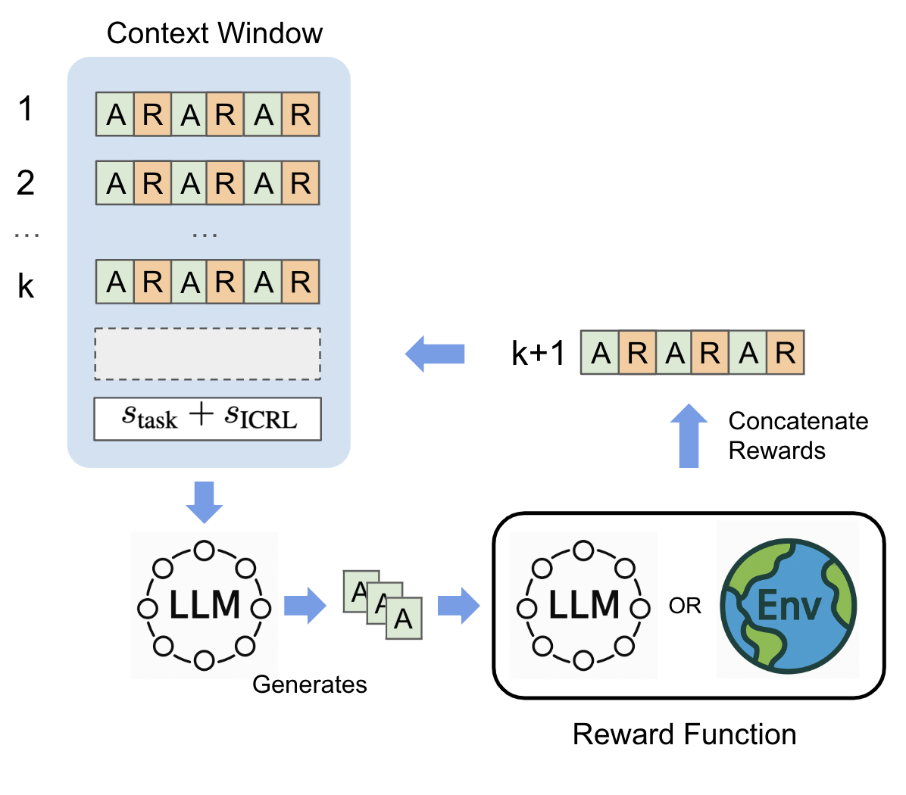

# Reward Is Enough: LLMs Are In-Context Reinforcement Learners

[](https://arxiv.org/abs/2506.06303)
[](https://iclr.cc/virtual/2026/poster/10007762)

This repository contains the code for reproducing the results in the paper "Reward Is Enough: LLMs Are In-Context Reinforcement Learners" (ICLR 2026).

<p align="center">
  
</p>

## Repository Structure

```
├── experiments/                          # Core ICRL experiments
│   ├── game24/                           # Game of 24
│   │   ├── game24_icrl.py               # ICRL (main method)
│   │   └── baselines/                   # Reflexion, Self-Refine, CoT, etc.
│   ├── creative_writing/                 # Creative Writing
│   │   ├── creative_writing_icrl.py     # ICRL (main method)
│   │   └── baselines/                   # Reflexion, Self-Refine, CoT, etc.
│   ├── math/                             # Math Competitions (AIME/HMMT)
│   └── sciworld/                         # ScienceWorld
├── analysis/                             # Analysis experiments & visualization
│   ├── attention_analysis/               # Reward-sensitive attention heads
│   ├── beyond_parametric_knowledge/      # ArXiv abstract generation
│   └── data_analysis/                    # Plotting & post-processing
├── ablation/                            # Separate SURF text-reward experiments and local dashboard
├── requirements/                         # Dependencies
│   ├── requirements_sciworld_math.txt    # ScienceWorld & Math experiments
│   └── requirements_creative_writing_game24.txt  # Creative Writing & Game of 24
└── README.md
```

## Shared Setup

Install the dependencies. We recommend using `uv`.

For ScienceWorld and Math experiments:
```bash
uv venv --python 3.11
source .venv/bin/activate
uv pip install -r requirements/requirements_sciworld_math.txt
```

For Creative Writing and Game of 24 experiments:
```bash
uv pip install -r requirements/requirements_creative_writing_game24.txt
```

## Text-reward ablation (SURF or Cliproxy smoke tests)

The separate [`ablation/`](ablation/) runner tests the three integer-reward tasks—Game of 24, Creative Writing, and ScienceWorld—with the reward *shown to the model* as a number (`numeric` baseline) or written in English (`en`), French (`fr`), or Chinese (`zh`). It uses [`dowhen`](https://pypi.org/project/dowhen/) at the reward-label boundary. Evaluation and aggregation retain the original integer value; only the feedback rendered in the model prompt changes. Game24's separate accuracy and format diagnostics are logged but are not added to its judge-return reward. Math is excluded because its soft reward is not always an integer.

This is a new implementation following the original task loops, not a byte-for-byte replay of their prompts or model backends. SURF conditions use the same fixed `openai/gpt-oss-120b` judge by default for Game24 and Creative Writing; ScienceWorld uses the environment reward. Use the numeric condition as the within-run baseline. The three SURF candidate model aliases are `gemma4` (`RedHatAI/gemma-4-31B-it-NVFP4`), `qwen35b` (`Qwen/Qwen3.6-35B-A3B-FP8`), and `oss120b` (`openai/gpt-oss-120b`). Qwen uses its [documented non-thinking request setting](https://huggingface.co/Qwen/Qwen3.6-35B-A3B-FP8) so the response is returned in `content` within the output budget; the exact model request options are saved in each run's `config.json` and held fixed across reward-language conditions. SURF may list a model without currently serving it; if Gemma is unloaded, that condition will stop with an API error and its partial log remains available.

From the repository root, create and activate the independent Conda environment (Python 3.12; `dowhen` requires 3.12 or newer):

```bash
conda env create --prefix "$PWD/.conda/ablation" --file ablation/environment.yml
conda activate "$PWD/.conda/ablation"
python -m unittest ablation.test_ablation
```

On some Conda installations, use `CONDA_NO_PLUGINS=true CONDA_PKGS_DIRS="$PWD/.conda/pkgs" conda env create --prefix "$PWD/.conda/ablation" --file ablation/environment.yml --solver classic` if the default solver/cache is unavailable. For ScienceWorld, Java is also required (`java -version`). Its local sentence-transformer action matcher downloads a model on first use. The original action matcher also needs NLTK's `wordnet` and `punkt_tab` data; install these once in your activated environment with `python -m nltk.downloader wordnet punkt_tab`.

Keep the existing root `.env` private and set `SURF_API_KEY=...` and/or `CLIPROXY_API_KEY=...` there. The runner reads only the selected provider's key locally; do not commit it. `SURF_API_BASE` and `CLIPROXY_API_BASE` can override the default endpoints.

Game24 and Creative Writing need the [Tree of Thoughts Game24 CSV](https://github.com/princeton-nlp/tree-of-thought-llm/blob/master/src/tot/data/24/24.csv) and [100 writing prompts](https://github.com/princeton-nlp/tree-of-thought-llm/blob/master/src/tot/data/text/data_100_random_text.txt). Fetch and validate both public files once with `python -m ablation.prepare_data`. This stores them in the Git-ignored `ablation/data/` folder, which the runner uses by default. You can still pass custom files with `--game24-data` and `--writing-data`. The Game24 default starts at puzzle index 900 and takes 100 puzzles, matching the original selection; Creative Writing takes 100 prompts. ScienceWorld uses 29 task environments by default. Game24 and Creative Writing default to 51 rounds, ScienceWorld to 40 rounds plus two initial attempts. Start with one condition if you want to inspect its behavior before launching the full, API-intensive matrix:

```bash
python -m ablation.run --task game24 --model qwen35b --feedback fr
python -m ablation.run --task creative_writing --model oss120b --feedback zh
python -m ablation.run --task sciworld --model qwen35b --feedback en
```

To run all three tasks, all three models, and all four feedback formats (36 conditions):

```bash
python -m ablation.run --task all --model all --feedback all --keep-going
```

For a cheap connectivity/functionality check when SURF is unavailable, Cliproxy currently offers `gpt6luna` (`gpt-6-luna`) and `gpt56luna` (`gpt-5.6-luna`). The runner uses `gpt-6-luna` as the Cliproxy judge by default. Try **one puzzle and one round** first:

```bash
python -m ablation.run --provider cliproxy --task game24 --model gpt6luna --feedback numeric --samples 1 --rounds 1 --max-tokens 512 --judge-max-tokens 128
```

This is a smoke test, not a substitute for the SURF comparison: a different candidate and judge change the experiment. Keep Cliproxy results separate when comparing conditions. OpenAI's published API prices may differ from Cliproxy's charges.

Use `--samples`, `--rounds`, `--history`, and `--max-env-steps` to control scope. `--judge-model` changes the fixed judge; keep it constant across conditions. Game24 and Creative Writing judge calls use a separate `--judge-max-tokens` budget (default 1024, including reasoning tokens). If a judge consumes its whole budget without a visible answer, it retries with 2× then 4× that budget and logs each attempt's token usage as `judge_call`. Candidate and judge calls also retry empty or whitespace-only answers at the same token budget after 5, 15, and 30 seconds, using the same retry limit as transient HTTP errors (including 408 timeouts). Each empty-response retry is logged. ScienceWorld retries the current step before applying an action, so empty responses do not consume environment steps or add rewards. Persistent empty responses still fail the run with saved progress intact; resume uses this retry logic automatically. A judge outage never becomes a zero reward. The default GPT-OSS judge uses low reasoning effort; this does not change GPT-OSS candidate generation. A malformed Game24 `<answer>` is scored as four zero steps with `invalid_generation` status, without calling the judge. These policies and judge settings are recorded in `config.json` and should be held constant across conditions. `--feedback en`, `fr`, or `zh` selects just one text format; `all` also includes the numeric baseline. `--keep-going` lets other conditions proceed if a model is unavailable and returns a failure status at the end. The runner writes append-only per-step evaluations, each attempt's numeric and displayed reward, prompts, responses, configuration, and final summary under `ablation/outputs/<task>/<model>/<feedback>/<run-id>/`. The run outputs are versioned in Git. Commit and push new or updated runs to store them on GitHub; generated Matplotlib font caches remain ignored. A completed condition also gets `reward.png` (mean numeric reward by round); regenerate a plot from a partial run with `python -m ablation.plot /absolute/path/to/run-directory`.

### Flipped-reward condition

Add `--reward-polarity flipped` to a new `ablation.run` condition. For example, from the repository root:

```bash
.conda/ablation/bin/python -m ablation.run --provider cliproxy --task game24 --model gpt6luna --feedback numeric --reward-polarity flipped
```

For a **new matched normal** Game24 condition, use the same provider, model, judge, feedback, data, sample count, and round count, and remove the placeholder scores from the worked examples in both conditions:

```bash
.conda/ablation/bin/python -m ablation.run --provider cliproxy --task game24 --model gpt6luna --feedback numeric --game24-demo-policy unscored
```

For Creative Writing, add `--writing-seed-policy judged` to the matched normal run. The flipped condition selects this policy automatically; both conditions then judge round 0 rather than assigning it a fixed score of 1. For Game24, the flipped condition automatically removes placeholder `Reward: 0` labels from its solved worked examples; the matched normal run should use `--game24-demo-policy unscored`. `--task all` applies both policies automatically in the flipped condition. Existing normal runs retain their historical policies, so compare against fresh matched runs. Reward polarity is separate from `--feedback numeric|en|fr|zh`. These commands make model and judge API calls; the dashboard does not.

To run all three tasks with one Cliproxy model and numeric feedback, use `--task all --model gpt6luna --provider cliproxy --feedback numeric --reward-polarity flipped`. For its new matched normal run, use the same command without `--reward-polarity flipped` and add `--game24-demo-policy unscored --writing-seed-policy judged`. You can instead select one task at a time; the runner saves each condition separately.

The judge or environment still produces the **true** `reward` used in plots and the dashboard. New events also store numeric `shown_reward` and its language-rendered `display_reward`, which are what the model sees. Game24 reverses valid intermediate scores with `3 - reward` and the final score with `10 - reward`; its shown attempt total is the sum of the four shown step scores. Creative Writing uses `11 - reward` for valid 1–10 scores. ScienceWorld uses `-reward` for each environment score change and for the attempt total. Malformed Game24 generations and invalid judge responses retain zero feedback and their failure status. The flipped output directory adds `/flipped/` between the feedback name and run ID, and both Game24 and ScienceWorld resume read the saved polarity and policies. Do not resume a normal run to create a flipped condition.

For the ScienceWorld GPT-6 Luna flipped-reward experiment on Slurm, submit from the repository root:

```bash
sbatch jobs/sciworld_luna_flipped.sbatch
```

This matches the normal and empty-reward jobs: Cliproxy, numeric feedback, 29 tasks, 40 rounds, two bootstrap attempts per task, 15 environment steps, 1000 output tokens, variation 0, `easy` simplifications, and full attempt history. It requests four CPUs, 64 GB RAM, and three days. Start a fresh run so that bootstrap attempts and all subsequent rounds receive flipped numeric feedback. The model's task instructions, actions, and observations, including textual success/failure notices, retain their normal meanings.

At each ScienceWorld step, the displayed reward is `-r`, where `r` is the true environment score change, including the corrected failure penalty. For example, `+20` becomes `-20`, `0` stays `0`, and `-100` becomes `+100`. If an attempt earns 30 points and then fails, the final true step reward is `-130`; its displayed value is `+130`, making the attempt's true total `-100` and displayed total `+100`. The displayed attempt total is the sum of displayed step rewards, so it always equals the negative true total. Both immediate feedback and prior-attempt history use these flipped values. True rewards remain in the event log, plots, and dashboard.

The job checks sign inversion and numeric formatting before API calls. Logs use `slurm-sciworld-luna-flipped-<job-id>.out` and `.err`; results go to `ablation/outputs/sciworld/gpt6luna/numeric/flipped/<run-id>/`. Compare the true reward curves, mean true reward over the final five rounds, and fraction of attempts scoring 100 against the normal and empty conditions. Repeated runs are needed to assess variability.

For a small API connectivity check, or to resume an interrupted flipped-reward run:

```bash
SAMPLES=1 ROUNDS=2 BOOTSTRAP_ATTEMPTS=0 MAX_ENV_STEPS=3 sbatch jobs/sciworld_luna_flipped.sbatch
RESUME_DIR=ablation/outputs/sciworld/gpt6luna/numeric/flipped/<run-id> sbatch jobs/sciworld_luna_flipped.sbatch
```

The resume check rejects other reward conditions; `RESUME_MODE` defaults to `auto`, and the saved configuration takes precedence over size overrides.

Math uses its separate runner. From `experiments/math`, in the environment used for that experiment, run `python math_bench.py flip_rewards=true postfix=flipped_reward` for deterministic `1 - true_reward` feedback. Its saved attempts keep the original score in `extra_fields.real_reward`; the `reward` field drives the model's history and sorting. Use `flip_rewards=false` for a new matched control. An invalid Math reward-model response now fails the run instead of being converted into zero and accidentally appearing as a perfect flipped score.

### Random-reward condition

Use `--reward-polarity random` for feedback sampled independently of the true score. For a Game24 smoke test:

```bash
python -m ablation.run --provider cliproxy --task game24 --model gpt6luna --feedback numeric --reward-polarity random --random-reward-seed 0 --samples 1 --rounds 2
```

Remove `--samples 1 --rounds 2` for the full experiment. Two rounds let the model receive the first attempt's random feedback. This condition still calls the judge to record true scores for evaluation; only model-visible rewards change. Game24 samples uniformly from `{0, 1, 3}` per intermediate step and `{0, 10}` for the final answer. Creative Writing samples uniformly from integers 1–10. ScienceWorld samples uniformly from integers −100 through 100 per environment step; this is a uniform noise control, not a match to the observed reward distribution. Attempt totals sum the shown step rewards. Failed evaluations retain the existing zero-feedback handling.

The seed (default 0) is saved as `random_reward_seed` in `config.json`. Each draw is keyed by seed, task, sample, round, and step, so feedback is reproducible across languages and Game24 resumes. Random conditions use the same `unscored` Game24 examples and `judged` writing seed policy as flipped conditions; use those policies for matched normal runs too. Outputs are stored under `<task>/<model>/<feedback>/random/<run-id>/` and labeled `random` in the dashboard, whose scores remain true rewards. Resume a random Game24 run using its saved output directory, without adding polarity or seed overrides.

For the full ScienceWorld GPT-6 Luna random-reward experiment on Slurm, submit from the repository root:

```bash
sbatch jobs/sciworld_luna_random.sbatch
```

This matches the normal, empty, and flipped jobs: Cliproxy, numeric feedback, 29 tasks, 40 rounds, two bootstrap attempts per task, 15 environment steps, 1000 output tokens, variation 0, `easy` simplifications, and full attempt history. It requests four CPUs, 64 GB RAM, and three days. Model-visible rewards are independent uniform integers from −100 through 100 per step; evaluation retains true environment rewards. The random feedback seed defaults to 0; use `RANDOM_REWARD_SEED=1 sbatch jobs/sciworld_luna_random.sbatch` for another seed. Logs use `slurm-sciworld-luna-random-<job-id>.out` and `.err`; results go to `ablation/outputs/sciworld/gpt6luna/numeric/random/<run-id>/`.

For a small API connectivity check, or to resume with the saved configuration and seed:

```bash
SAMPLES=1 ROUNDS=2 BOOTSTRAP_ATTEMPTS=0 MAX_ENV_STEPS=3 sbatch jobs/sciworld_luna_random.sbatch
RESUME_DIR=ablation/outputs/sciworld/gpt6luna/numeric/random/<run-id> sbatch jobs/sciworld_luna_random.sbatch
```

### Empty-reward condition

Use `--reward-polarity empty` to keep prior attempts in context while removing their reward labels and values. A `dowhen` intervention clears the displayed reward at the shared feedback boundary, including with `--feedback numeric`, for both new and resumed runs. Game24 also uses unscored worked examples, and ScienceWorld hides the immediate reward in each observation message. Judges and the environment still supply numeric scores for evaluation, including judged round 0 in Creative Writing.

```bash
.conda/ablation/bin/python -m ablation.run --task game24 --model gpt6luna --provider cliproxy --feedback numeric --reward-polarity empty --samples 1 --rounds 2
```

This also works with `--task creative_writing`, `--task sciworld`, or `--task all`. Use one feedback format for this condition since there are no values to render. Runs are saved under `<feedback>/empty/<run-id>/` and listed as `empty` in the dashboard. The event log records `shown_reward: null` and a blank `display_reward`. For matched normal runs use `--game24-demo-policy unscored` and/or `--writing-seed-policy judged` as applicable.

For the ScienceWorld GPT-6 Luna empty-reward experiment on Slurm, submit from the repository root:

```bash
sbatch jobs/sciworld_luna_empty.sbatch
```

This matches `jobs/sciworld_luna_normal.sbatch`: Cliproxy, numeric feedback, 29 tasks, 40 rounds, two bootstrap attempts per task, 15 environment steps, and 1000 output tokens. It uses the same variation 0, `easy` simplifications, and full attempt history. The job checks the `dowhen` empty-reward intervention before making API calls. Logs are written to `slurm-sciworld-luna-empty-<job-id>.out` and `.err`; results go to `ablation/outputs/sciworld/gpt6luna/numeric/empty/<run-id>/`. It requests four CPUs, 64 GB RAM, and three days, like the baseline.

For a small API connectivity check, or to resume an interrupted empty-reward run:

```bash
SAMPLES=1 ROUNDS=1 BOOTSTRAP_ATTEMPTS=0 MAX_ENV_STEPS=3 sbatch jobs/sciworld_luna_empty.sbatch
RESUME_DIR=ablation/outputs/sciworld/gpt6luna/numeric/empty/<run-id> sbatch jobs/sciworld_luna_empty.sbatch
```

The resume check rejects other reward conditions; `RESUME_MODE` defaults to `auto`, and the saved configuration takes precedence over size overrides.

To continue an interrupted **Game24 or ScienceWorld** run later, with its saved provider, models, feedback, and data (so the relevant API must be reachable), use:

```bash
python -m ablation.run --resume /absolute/path/to/run-directory
```

After moving a run from Linux to macOS, its saved absolute data path may no longer exist. Prepare the data locally and override only its location (the input dataset must match the original):

```bash
python -m ablation.prepare_data
python -m ablation.run --resume ablation/outputs/game24/gpt6luna/numeric/flipped/20261028T090654Z-cf363f14 --game24-data ablation/data/24.csv
```

The original `config.json` is preserved; the resolved data path is recorded in the new `run_resume` event. The environment includes Java 21 for ScienceWorld.

Resume reuses completed attempts, a saved generation, and any contiguous step evaluations already recorded for an incomplete attempt. It judges only the remaining steps, avoiding duplicate rewards; duplicate, out-of-order, or invalid saved step records stop the resume for inspection. Older runs can be resumed, but their new attempts follow the corrected invalid-output/judge-retry policy; for a publishable comparison, start fresh runs for every condition under one policy. Do not resume a SURF run using Cliproxy.

ScienceWorld writes an atomic `checkpoint.json` after each completed attempt and round. It stores completed histories, the task manifest, and a checksum of the event-log prefix. Each model response and step evaluation is flushed to disk before continuing. Resume restores the snapshot and reads subsequent events; runs without a snapshot are recovered from `events.jsonl`. An invalid or stale snapshot is rebuilt from the validated event log. Completed attempts and their scores are reused without model calls.

For the unfinished attempt, the default `auto` mode replays saved responses from a reset simulator and verifies prompts, observations, terminal flags, and rewards before requesting new responses. ScienceWorld can return different object names after a restart. If replay differs, **only that unfinished attempt** restarts; its earlier partial records remain in the audit log with an `attempt_restart` event and do not contribute a duplicate attempt score. Use `--sciworld-resume-mode strict` to stop on any replay difference, or `--sciworld-resume-mode restart-attempt` to skip replay and restart the unfinished attempt immediately. Dependencies, task selection, feedback, and reward policy must still match the saved run.

If a process dies while writing its last event, resume archives and removes only an invalid final record lacking a newline. A complete final JSON record lacking its newline is retained. Other inconsistent records stop recovery for inspection. A crash before a model response reaches the log can still require repeating that API call.

On an API HTTP 400 during a ScienceWorld attempt, the runner backs up one completed action and generates a replacement. For example, if the request for step 3 is rejected, it discards step 2, resets the simulator, replays and verifies step 1 without a model call, and requests a fresh step 2. The removed action, observation, and reward are excluded from the active prompt and attempt total. Original records remain in the audit log with an `attempt_backtrack` marker; checkpoint and event-log recovery honor that marker without duplicating rewards. Completed attempts and rounds are retained. If replay differs, the existing resume mode controls whether to restart the unfinished attempt or stop.

The default is five API 400 backtracks per attempt, including across process resumes and attempt restarts. New configurations record this limit as `sciworld_api400_backtracks`. Saved runs with a lower allowance automatically use five on resume, without rewriting their original configuration; the `run_resume` event records the effective limit. Backtracks already used still count, so an interrupted attempt that used three has two more available. Recovery and log validation use the same effective limit.

If the first action receives HTTP 400 with code `invalid_prompt`, there is no preceding action to undo. The runner instead retries the same prompt up to three times, after 5, 15, and 30 seconds (four requests total). Each retry is recorded as `attempt_retry`; rejected requests do not apply actions or add rewards. The retry count survives checkpoints, process resumes, and attempt restarts, and completed attempts and rounds are retained. This applies to bootstrap and regular attempts under every reward condition. New configurations save the delays as `sciworld_first_step_400_retry_delays`; older runs use the same defaults automatically on resume, without changing their saved configuration. Persistent rejection stops with progress intact; other first-action HTTP 400 errors still fail immediately. Other API failures retain their existing handling. Retries cannot guarantee that a rejected prompt will succeed. To run the offline checks, use `python -m unittest ablation.test_sciworld_backtrack ablation.test_sciworld_checkpoint ablation.test_sciworld ablation.test_ablation`.

For example, continue the interrupted November 13 SciWorld run from the repository root:

```bash
RESUME_DIR=ablation/outputs/sciworld/gpt6luna/numeric/20261113T000323Z-2a364360 \\
sbatch jobs/sciworld_luna_normal.sbatch
```

The job script defaults to `RESUME_MODE=auto`; set `RESUME_MODE=strict` or `RESUME_MODE=restart-attempt` to select another recovery mode. The original configuration and completed results stay in the same run directory.

ScienceWorld runs created before the corrected failure-reward policy cannot be resumed: start fresh matched conditions. Failure now contributes `-100 - previous_score`, so an attempt that earns 30 points and then fails totals −100, rather than −40. The policy is recorded in new run configurations; historical output files retain their original scores.

From the repository root, launch the local-only live dashboard with the ablation environment's Python (activation is optional), then open <http://127.0.0.1:8765>:

```bash
.conda/ablation/bin/python -m ablation.dashboard
```

The dashboard refreshes every two seconds and shows per-step/per-attempt numeric rewards and their displayed text. The run dropdown includes each run's local date/time and status (`running`, `succeeded`, `failed`, or `incomplete`); failed runs remain listed. For Game24, its main trial-by-trial curve is the mean rule-based success rate (correct expression using all four numbers), as in Figure 2 of the paper. A separate curve shows the mean total judge reward, and four smaller curves show the mean judge reward for Steps 1-3 and the final answer separately. Other tasks show mean numeric reward by trial. Shading is ±1 standard error across evaluated samples, and an open dot marks a partial trial. Hover over a chart to see the nearest iteration's y value, a vertical guide, and its iteration label on the x axis. With only trial 0 available, you will see one point; the line appears when trial 1 begins. The dashboard reads the local output directory and does not call SURF. Select a task, then check multiple runs to overlay their curves with a shared color legend. The uncertainty controls choose standard error or sample standard deviation across puzzles, scaled by 1×, 2×, or 3×. Standard deviation requires at least two samples. The curve control offers raw means, EMA on all iterations, or EMA using only odd iterations (1, 3, 5, …), with adjustable α (default 0.30). EMA bands retain the raw across-puzzle spread at each included iteration and are centered on the smoothed mean. Bands are clipped at score limits on bounded Game24 charts. The Inspect run dropdown selects which run supplies the event table. Restart it after updating the code to see the new controls.

## Game of 24

Configure the OpenAI API key and specify which ICRL method or ablation to run in the file, then run:
```bash
cd experiments/game24
python game24_icrl.py
```

Run baselines:
```bash
python baselines/game24_reflexion.py
python baselines/game24_self_refine.py
python baselines/game24_rejection.py
python baselines/game24_cot.py
```


## Creative Writing

Configure the OpenAI API key and specify which ICRL method or ablation to run in the file, then run:
```bash
cd experiments/creative_writing
python creative_writing_icrl.py
```

Run baselines:
```bash
python baselines/creative_writing_reflexion.py
python baselines/creative_writing_self_refine.py
python baselines/creative_writing_cot.py
```

## ScienceWorld

### Setup

Make sure you have Java 1.8+ installed
```bash
javac -version
```

The independent ablation environment includes Python 3.12, Java 21, and the pinned ScienceWorld 1.1.3 package with its bundled simulator. From the repository root:
```bash
conda env create --prefix "$PWD/.conda/ablation" --file ablation/environment.yml
conda activate "$PWD/.conda/ablation"
python -m nltk.downloader wordnet punkt_tab
python -m unittest ablation.test_ablation ablation.test_sciworld
```

If that environment already exists, just activate it. The MiniLM action matcher downloads its public weights on first use and runs on CPU. ScienceWorld does not need the Game24 or writing datasets, and its rewards come directly from the simulator without a judge API. Both runners share the ScienceWorld API compatibility and corrected reward patch. The original runner needs `OPENAI_API_KEY` (or `OPENROUTER_API_KEY` for candidate models whose names contain `/`); its default action matcher also uses OpenAI embeddings. Set `use_openai_embedding=false` to use local MiniLM instead. The ablation runner always uses local MiniLM and the selected provider's key.

To check the local simulator without model API calls, after caching MiniLM:

```bash
SCIWORLD_LIVE=1 python -m unittest ablation.test_sciworld_live
```

These checks cover every available task type at variation 0 with `easy` simplifications, including resets, invalid actions, and step limits. They also exercise the grow-plant seed dialog with numbered choices, repeated action text, and cancellation. The wrapper resolves clarification choices from the simulator's observation and rejects unmatched replies without sending a null action to Java. Java error details are captured before cleanup closes the gateway.

For a small ablation smoke test (makes candidate model API calls):

```bash
python -m ablation.run --task sciworld --provider surf --model qwen35b \
  --feedback numeric --samples 1 --rounds 1 --bootstrap-attempts 0 --max-env-steps 3
```

The default task selection preserves the original experiment: sort all task names, omit the first, and use variation 0 with `easy` simplifications. For explicit tasks and a different variation:

```bash
python -m ablation.run --task sciworld --provider surf --model qwen35b \
  --feedback numeric --sciworld-tasks boil freeze --variation-idx 2
```

`--sciworld-tasks` sets the sample count to the number of named tasks and can include the task omitted by the default selection. `--variation-idx` is the actual simulator variation ID, applied to each selected task. Run separate conditions for each variation when sweeping variations. `--sciworld-split train|dev|test` validates that this ID belongs to the requested split for every selected task; incompatible IDs fail before candidate calls. `--simplifications ""` disables the default `easy` simplifications. Keep task IDs, variation IDs, simplifications, history, rounds, and step limits identical across reward conditions. These selection options are saved and cannot be overridden when resuming. The default 15-step budget matches this repository's original ICRL configuration; longer scientific procedures may require a larger budget.

The checked-in ScienceWorld results are small functionality checks, not a full benchmark. A full experiment still needs fresh matched runs across the intended models, reward conditions, and variations. At the default 29 tasks, 40 rounds, two initial attempts, and 15 steps, one condition can make up to 18,270 candidate calls.

For Slurm on the Anunna cluster, submit the normal numeric baseline with GPT-6 Luna through Cliproxy from the repository root:

```bash
sbatch jobs/sciworld_luna_normal.sbatch
```

The job requests the `main` CPU partition, four CPUs, 64 GB RAM, and three days. It uses `.conda/ablation`, cached MiniLM weights, and the private root `.env`; it does not need a GPU. Output is saved in the usual `ablation/outputs/sciworld/gpt6luna/numeric/` directory, with Slurm logs named `slurm-sciworld-luna-<job-id>.out` and `.err` in the submission directory. The full defaults match the baseline above. For a small API connectivity test instead:

```bash
SAMPLES=1 ROUNDS=1 BOOTSTRAP_ATTEMPTS=0 MAX_ENV_STEPS=3 sbatch jobs/sciworld_luna_normal.sbatch
```

Resume an interrupted normal Luna run with `RESUME_DIR=ablation/outputs/sciworld/gpt6luna/numeric/<run-id> sbatch jobs/sciworld_luna_normal.sbatch`. Resume uses the saved run configuration. `SAMPLES`, `ROUNDS`, `BOOTSTRAP_ATTEMPTS`, `MAX_ENV_STEPS`, and `MAX_TOKENS` customize new jobs; `REPO_DIR` and `ENV_PREFIX` override the repository and environment locations. Compute nodes must be able to reach the Cliproxy endpoint.

#### French reward feedback on Slurm

Submit from the repository root:

```bash
sbatch jobs/sciworld_luna_french.sbatch
```

The job shares the GPT-6 Luna numeric baseline settings, including 29 tasks, 40 rounds, two bootstrap attempts per task, a 15-step limit, variation 0, `easy` simplifications, and full attempt history. Reward values in model prompts are spelled out in French. Evaluation uses the simulator's integer scores. Results go to `ablation/outputs/sciworld/gpt6luna/fr/<run-id>/`, with Slurm logs named `slurm-sciworld-luna-french-<job-id>.out` and `.err`.

Resume an interrupted French run with its saved configuration:

```bash
RESUME_DIR=ablation/outputs/sciworld/gpt6luna/fr/<run-id> sbatch jobs/sciworld_luna_french.sbatch
```

### Running the experiments

```bash
cd experiments/sciworld
```

Run ICRL preset:
```bash
python3 sciworld.py icrl_mode=ICRL num_envs=29
```

Run ICRL ablations, e.g. explore_only:
```bash
python3 sciworld.py icrl_mode=ICRL num_envs=29 explore_only=true
```

Run other baselines, e.g. random sampling:
```bash
python3 sciworld.py icrl_mode=RANDOM_SAMPLING num_envs=29 max_env_steps=200
```

For all the other options available including the ablations and baselines, refer to the `SciWorldConfig` class in `experiments/sciworld/sciworld.py`.

The original runner also accepts `variation_idx=...` and `simplifications=...`. New original-runner checkpoints record the corrected reward policy; older checkpoints must be replaced with fresh matched runs.

## Math Competitions (AIME/HMMT)

```bash
cd experiments/math
python math_bench.py
```

## Beyond Parametric Knowledge (ArXiv Abstract Generation)

```bash
cd analysis/beyond_parametric_knowledge
```

Run ICRL:
```bash
python beyond_parametric_knowledge.py
```

Run Best-of-N baseline:
```bash
python beyond_parametric_knowledge.py --rejection_sampling
```

Run exploitation-only ablation:
```bash
python beyond_parametric_knowledge.py --exploitation_only
```

Run exploration-only ablation:
```bash
python beyond_parametric_knowledge.py --explore_only
```

## Attention Analysis (Reward-Sensitive Heads)

Analyzes attention patterns in Qwen3-32B to identify reward-sensitive heads. Requires 2 GPUs.

```bash
cd analysis/attention_analysis
```

Run the initial analysis (layers -1 to -4, 64 heads each):
```bash
bash test_layers_heads.sh <path_to_output_list.json>
```

Run the extended analysis across all 32 layers:
```bash
bash run_all_layers.sh <path_to_output_list.json>
```

Generate the significant heads figure:
```bash
python plot_significant_heads_bar.py
```

> Acknowledgement:
> We have borrowed code from the [ScienceWorld](https://github.com/allenai/ScienceWorld), [ARMAP](https://github.com/heaplax/ARMAP), and [CLIN](https://github.com/allenai/clin) repositories.

## Citation

```bibtex
@inproceedings{song2026reward,
      title={Reward Is Enough: LLMs Are In-Context Reinforcement Learners}, 
      author={Kefan Song and Amir Moeini and Peng Wang and Lei Gong and Rohan Chandra and Shangtong Zhang and Yanjun Qi},
      booktitle={International Conference on Learning Representations (ICLR)},
      year={2026},
      eprint={2506.06303},
      archivePrefix={arXiv},
      primaryClass={cs.LG},
      url={https://arxiv.org/abs/2506.06303}, 
}
```
