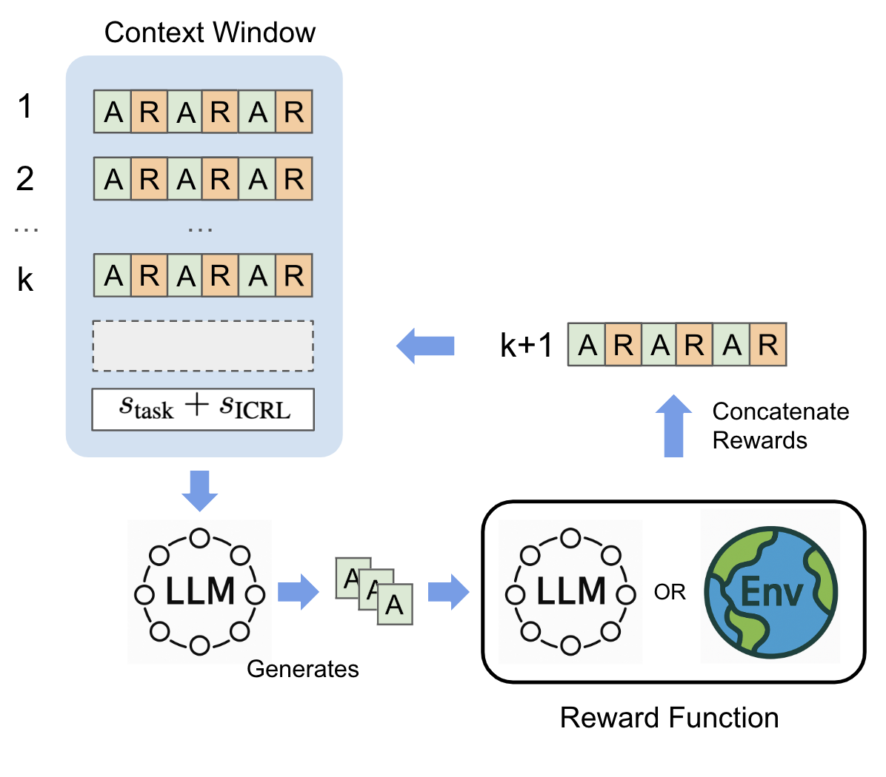

# Reward Is Enough: LLMs Are In-Context Reinforcement Learners

[](https://arxiv.org/abs/2506.06303)
[](https://iclr.cc/virtual/2026/poster/10007762)

This repository contains the code for reproducing the results in the paper "Reward Is Enough: LLMs Are In-Context Reinforcement Learners" (ICLR 2026).

<p align="center">
  
</p>

## Repository Structure

```
├── experiments/                          # Core ICRL experiments
│   ├── game24/                           # Game of 24
│   │   ├── game24_icrl.py               # ICRL (main method)
│   │   └── baselines/                   # Reflexion, Self-Refine, CoT, etc.
│   ├── creative_writing/                 # Creative Writing
│   │   ├── creative_writing_icrl.py     # ICRL (main method)
│   │   └── baselines/                   # Reflexion, Self-Refine, CoT, etc.
│   ├── math/                             # Math Competitions (AIME/HMMT)
│   └── sciworld/                         # ScienceWorld
├── analysis/                             # Analysis experiments & visualization
│   ├── attention_analysis/               # Reward-sensitive attention heads
│   ├── beyond_parametric_knowledge/      # ArXiv abstract generation
│   └── data_analysis/                    # Plotting & post-processing
├── ablation/                            # Separate SURF text-reward experiments and local dashboard
├── requirements/                         # Dependencies
│   ├── requirements_sciworld_math.txt    # ScienceWorld & Math experiments
│   └── requirements_creative_writing_game24.txt  # Creative Writing & Game of 24
└── README.md
```

## Shared Setup

Install the dependencies. We recommend using `uv`.

For ScienceWorld and Math experiments:
```bash
uv venv --python 3.11
source .venv/bin/activate
uv pip install -r requirements/requirements_sciworld_math.txt
```

For Creative Writing and Game of 24 experiments:
```bash
uv pip install -r requirements/requirements_creative_writing_game24.txt
```

## Text-reward ablation (SURF or Cliproxy smoke tests)

The separate [`ablation/`](ablation/) runner tests the three integer-reward tasks—Game of 24, Creative Writing, and ScienceWorld—with the reward *shown to the model* as a number (`numeric` baseline) or written in English (`en`), French (`fr`), or Chinese (`zh`). It uses [`dowhen`](https://pypi.org/project/dowhen/) at the reward-label boundary. Evaluation and aggregation retain the original integer value; only the feedback rendered in the model prompt changes. Game24's separate accuracy and format diagnostics are logged but are not added to its judge-return reward. Math is excluded because its soft reward is not always an integer.

This is a new implementation following the original task loops, not a byte-for-byte replay of their prompts or model backends. SURF conditions use the same fixed `openai/gpt-oss-120b` judge by default for Game24 and Creative Writing; ScienceWorld uses the environment reward. Use the numeric condition as the within-run baseline. The three SURF candidate model aliases are `gemma4` (`RedHatAI/gemma-4-31B-it-NVFP4`), `qwen35b` (`Qwen/Qwen3.6-35B-A3B-FP8`), and `oss120b` (`openai/gpt-oss-120b`). Qwen uses its [documented non-thinking request setting](https://huggingface.co/Qwen/Qwen3.6-35B-A3B-FP8) so the response is returned in `content` within the output budget; the exact model request options are saved in each run's `config.json` and held fixed across reward-language conditions. SURF may list a model without currently serving it; if Gemma is unloaded, that condition will stop with an API error and its partial log remains available.

From the repository root, create and activate the independent Conda environment (Python 3.12; `dowhen` requires 3.12 or newer):

```bash
conda env create --prefix "$PWD/.conda/ablation" --file ablation/environment.yml
conda activate "$PWD/.conda/ablation"
python -m unittest ablation.test_ablation
```

On some Conda installations, use `CONDA_NO_PLUGINS=true CONDA_PKGS_DIRS="$PWD/.conda/pkgs" conda env create --prefix "$PWD/.conda/ablation" --file ablation/environment.yml --solver classic` if the default solver/cache is unavailable. For ScienceWorld, Java is also required (`java -version`). Its local sentence-transformer action matcher downloads a model on first use. The original action matcher also needs NLTK's `wordnet` and `punkt_tab` data; install these once in your activated environment with `python -m nltk.downloader wordnet punkt_tab`.

Keep the existing root `.env` private and set `SURF_API_KEY=...` and/or `CLIPROXY_API_KEY=...` there. The runner reads only the selected provider's key locally; do not commit it. `SURF_API_BASE` and `CLIPROXY_API_BASE` can override the default endpoints.

Game24 and Creative Writing need the [Tree of Thoughts Game24 CSV](https://github.com/princeton-nlp/tree-of-thought-llm/blob/master/src/tot/data/24/24.csv) and [100 writing prompts](https://github.com/princeton-nlp/tree-of-thought-llm/blob/master/src/tot/data/text/data_100_random_text.txt). Fetch and validate both public files once with `python -m ablation.prepare_data`. This stores them in the Git-ignored `ablation/data/` folder, which the runner uses by default. You can still pass custom files with `--game24-data` and `--writing-data`. The Game24 default starts at puzzle index 900 and takes 100 puzzles, matching the original selection; Creative Writing takes 100 prompts. ScienceWorld uses 29 task environments by default. Game24 and Creative Writing default to 51 rounds, ScienceWorld to 40 rounds plus two initial attempts. Start with one condition if you want to inspect its behavior before launching the full, API-intensive matrix:

```bash
python -m ablation.run --task game24 --model qwen35b --feedback fr
python -m ablation.run --task creative_writing --model oss120b --feedback zh
python -m ablation.run --task sciworld --model qwen35b --feedback en
```

To run all three tasks, all three models, and all four feedback formats (36 conditions):

```bash
python -m ablation.run --task all --model all --feedback all --keep-going
```

For a cheap connectivity/functionality check when SURF is unavailable, Cliproxy currently offers `gpt6luna` (`gpt-6-luna`) and `gpt56luna` (`gpt-5.6-luna`). The runner uses `gpt-6-luna` as the Cliproxy judge by default. Try **one puzzle and one round** first:

```bash
python -m ablation.run --provider cliproxy --task game24 --model gpt6luna --feedback numeric --samples 1 --rounds 1 --max-tokens 512 --judge-max-tokens 128
```

This is a smoke test, not a substitute for the SURF comparison: a different candidate and judge change the experiment. Keep Cliproxy results separate when comparing conditions. OpenAI's published API prices may differ from Cliproxy's charges.

Use `--samples`, `--rounds`, `--history`, and `--max-env-steps` to control scope. `--judge-model` changes the fixed judge; keep it constant across conditions. Game24 and Creative Writing judge calls use a separate `--judge-max-tokens` budget (default 1024, including reasoning tokens). If a judge consumes its whole budget without a visible answer, it retries with 2× then 4× that budget and logs each attempt's token usage as `judge_call`. Transient HTTP 408 timeouts are also retried. It still fails the run if all attempts are empty; a judge outage never becomes a zero reward. The default GPT-OSS judge uses low reasoning effort; this does not change GPT-OSS candidate generation. A malformed Game24 `<answer>` is scored as four zero steps with `invalid_generation` status, without calling the judge. These policies and judge settings are recorded in `config.json` and should be held constant across conditions. `--feedback en`, `fr`, or `zh` selects just one text format; `all` also includes the numeric baseline. `--keep-going` lets other conditions proceed if a model is unavailable and returns a failure status at the end. The runner writes append-only per-step evaluations, each attempt's numeric and displayed reward, prompts, responses, configuration, and final summary under `ablation/outputs/<task>/<model>/<feedback>/<run-id>/`. The directory is local and Git-ignored. A completed condition also gets `reward.png` (mean numeric reward by round); regenerate a plot from a partial run with `python -m ablation.plot /absolute/path/to/run-directory`.

### Flipped-reward condition

Add `--reward-polarity flipped` to a new `ablation.run` condition. For example, from the repository root:

```bash
.conda/ablation/bin/python -m ablation.run --provider cliproxy --task game24 --model gpt6luna --feedback numeric --reward-polarity flipped
```

For a **new matched normal** Game24 condition, use the same provider, model, judge, feedback, data, sample count, and round count, and remove the placeholder scores from the worked examples in both conditions:

```bash
.conda/ablation/bin/python -m ablation.run --provider cliproxy --task game24 --model gpt6luna --feedback numeric --game24-demo-policy unscored
```

For Creative Writing, add `--writing-seed-policy judged` to the matched normal run. The flipped condition selects this policy automatically; both conditions then judge round 0 rather than assigning it a fixed score of 1. For Game24, the flipped condition automatically removes placeholder `Reward: 0` labels from its solved worked examples; the matched normal run should use `--game24-demo-policy unscored`. `--task all` applies both policies automatically in the flipped condition. Existing normal runs retain their historical policies, so compare against fresh matched runs. Reward polarity is separate from `--feedback numeric|en|fr|zh`. These commands make model and judge API calls; the dashboard does not.

To run all three tasks with one Cliproxy model and numeric feedback, use `--task all --model gpt6luna --provider cliproxy --feedback numeric --reward-polarity flipped`. For its new matched normal run, use the same command without `--reward-polarity flipped` and add `--game24-demo-policy unscored --writing-seed-policy judged`. You can instead select one task at a time; the runner saves each condition separately.

The judge or environment still produces the **true** `reward` used in plots and the dashboard. New events also store numeric `shown_reward` and its language-rendered `display_reward`, which are what the model sees. Game24 reverses valid intermediate scores with `3 - reward` and the final score with `10 - reward`; its shown attempt total is the sum of the four shown step scores. Creative Writing uses `11 - reward` for valid 1–10 scores. ScienceWorld uses `-reward` for each environment score change and for the attempt total. Malformed Game24 generations and invalid judge responses retain zero feedback and their failure status. The flipped output directory adds `/flipped/` between the feedback name and run ID, and Game24 resume reads the saved polarity and policies. Do not resume a normal run to create a flipped condition.

Math uses its separate runner. From `experiments/math`, in the environment used for that experiment, run `python math_bench.py flip_rewards=true postfix=flipped_reward` for deterministic `1 - true_reward` feedback. Its saved attempts keep the original score in `extra_fields.real_reward`; the `reward` field drives the model's history and sorting. Use `flip_rewards=false` for a new matched control. An invalid Math reward-model response now fails the run instead of being converted into zero and accidentally appearing as a perfect flipped score.

To continue an interrupted **Game24** run later, with its saved provider, models, feedback, and data (so the relevant API must be reachable), use:

```bash
python -m ablation.run --resume /absolute/path/to/run-directory
```

Resume reuses completed attempts, a saved generation, and any contiguous step evaluations already recorded for an incomplete attempt. It judges only the remaining steps, avoiding duplicate rewards; duplicate, out-of-order, or invalid saved step records stop the resume for inspection. Older runs can be resumed, but their new attempts follow the corrected invalid-output/judge-retry policy; for a publishable comparison, start fresh runs for every condition under one policy. Do not resume a SURF run using Cliproxy.

From the repository root, launch the local-only live dashboard with the ablation environment's Python (activation is optional), then open <http://127.0.0.1:8765>:

```bash
.conda/ablation/bin/python -m ablation.dashboard
```

The dashboard refreshes every two seconds and shows per-step/per-attempt numeric rewards and their displayed text. The run dropdown includes each run's local date/time and status (`running`, `succeeded`, `failed`, or `incomplete`); failed runs remain listed. For Game24, its main trial-by-trial curve is the mean rule-based success rate (correct expression using all four numbers), as in Figure 2 of the paper. A separate curve shows the mean total judge reward, and four smaller curves show the mean judge reward for Steps 1-3 and the final answer separately. Other tasks show mean numeric reward by trial. Shading is ±1 standard error across evaluated samples, and an open dot marks a partial trial. Hover over a chart to see the nearest iteration's y value, a vertical guide, and its iteration label on the x axis. With only trial 0 available, you will see one point; the line appears when trial 1 begins. The dashboard reads the local output directory and does not call SURF. Restart it after updating the code to see the new charts.

## Game of 24

Configure the OpenAI API key and specify which ICRL method or ablation to run in the file, then run:
```bash
cd experiments/game24
python game24_icrl.py
```

Run baselines:
```bash
python baselines/game24_reflexion.py
python baselines/game24_self_refine.py
python baselines/game24_rejection.py
python baselines/game24_cot.py
```


## Creative Writing

Configure the OpenAI API key and specify which ICRL method or ablation to run in the file, then run:
```bash
cd experiments/creative_writing
python creative_writing_icrl.py
```

Run baselines:
```bash
python baselines/creative_writing_reflexion.py
python baselines/creative_writing_self_refine.py
python baselines/creative_writing_cot.py
```

## ScienceWorld

### Setup

Make sure you have Java 1.8+ installed
```bash
javac -version
```

Clone the ScienceWorld repository and install it
```bash
git clone https://github.com/allenai/ScienceWorld.git
cd ScienceWorld
pip install -e .
```

### Running the experiments

```bash
cd experiments/sciworld
```

Run ICRL preset:
```bash
python3 sciworld.py icrl_mode=ICRL num_envs=29
```

Run ICRL ablations, e.g. explore_only:
```bash
python3 sciworld.py icrl_mode=ICRL num_envs=29 explore_only=true
```

Run other baselines, e.g. random sampling:
```bash
python3 sciworld.py icrl_mode=RANDOM_SAMPLING num_envs=29 max_env_steps=200
```

For all the other options available including the ablations and baselines, refer to the `SciWorldConfig` class in `experiments/sciworld/sciworld.py`.

## Math Competitions (AIME/HMMT)

```bash
cd experiments/math
python math_bench.py
```

## Beyond Parametric Knowledge (ArXiv Abstract Generation)

```bash
cd analysis/beyond_parametric_knowledge
```

Run ICRL:
```bash
python beyond_parametric_knowledge.py
```

Run Best-of-N baseline:
```bash
python beyond_parametric_knowledge.py --rejection_sampling
```

Run exploitation-only ablation:
```bash
python beyond_parametric_knowledge.py --exploitation_only
```

Run exploration-only ablation:
```bash
python beyond_parametric_knowledge.py --explore_only
```

## Attention Analysis (Reward-Sensitive Heads)

Analyzes attention patterns in Qwen3-32B to identify reward-sensitive heads. Requires 2 GPUs.

```bash
cd analysis/attention_analysis
```

Run the initial analysis (layers -1 to -4, 64 heads each):
```bash
bash test_layers_heads.sh <path_to_output_list.json>
```

Run the extended analysis across all 32 layers:
```bash
bash run_all_layers.sh <path_to_output_list.json>
```

Generate the significant heads figure:
```bash
python plot_significant_heads_bar.py
```

> Acknowledgement:
> We have borrowed code from the [ScienceWorld](https://github.com/allenai/ScienceWorld), [ARMAP](https://github.com/heaplax/ARMAP), and [CLIN](https://github.com/allenai/clin) repositories.

## Citation

```bibtex
@inproceedings{song2026reward,
      title={Reward Is Enough: LLMs Are In-Context Reinforcement Learners}, 
      author={Kefan Song and Amir Moeini and Peng Wang and Lei Gong and Rohan Chandra and Shangtong Zhang and Yanjun Qi},
      booktitle={International Conference on Learning Representations (ICLR)},
      year={2026},
      eprint={2506.06303},
      archivePrefix={arXiv},
      primaryClass={cs.LG},
      url={https://arxiv.org/abs/2506.06303}, 
}
```
